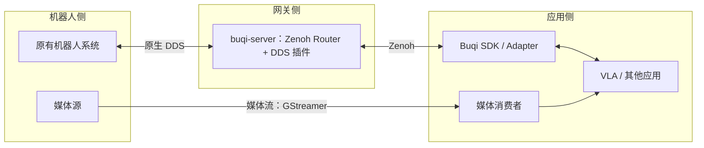

# 不器 · Buqi

不器是一个面向异构机器人的通信与接口框架，目标是在尽量保持机器人现有系统不变的前提下，
让应用更容易访问不同机器人的能力。

名称取自《论语·为政》“君子不器”，希望机器人应用不被单一厂商、协议或框架所限。

> 项目处于工程初始化与接口设计阶段，以下架构描述的是目标设计，并非已交付的功能。

## 为什么做不器

机器人已有各自的通信协议和厂商 SDK，VLA 等上层应用则通常使用 Python。
仅打通网络，还不能消除机器人之间的消息格式、控制接口和使用方式差异。

不器希望把通信接入与接口适配分开：网关连接机器人侧网络与应用，
客户端 SDK 通过 Adapter 封装具体机器人，让应用逐步摆脱对底层通信细节的依赖。

## 设计思路

- **机器人侧保持原样**：复用已有系统与通信接口，不强制部署新的机器人 Runtime。
- **网关只负责通信**：通过 Zenoh 路由和协议桥接连接各端，不承载厂商 SDK 或机器人业务逻辑。
- **接口抽象放在客户端**：以 Python SDK 支持 VLA 等应用，通过 Adapter 适配不同机器人；
  Rust SDK 在 Python 接口稳定后对齐。
- **多媒体单独组织**：规划使用 GStreamer 处理视频等媒体流，与 Zenoh 上的控制、状态通信分开。

### 目标架构

当前优先面向宇树 G1 系列的 DDS 接入场景：机器人本体（PC1）保持不变，
新增网关部署在 PC2；PC1、PC2 是这一场景的部署角色，不是所有机器人的固定拓扑。

Zenoh 承担核心通信，DDS 互通复用 `zenoh-plugin-dds`。
MQTT、ZMQ 等其他协议的接入仍需各自的桥接或适配，不属于当前已实现能力。
图中媒体连线仅表示逻辑分流，具体传输协议及管线部署位置待定；
链路分离不等于带宽、时延或硬实时保证。

### 两种使用路径

- **原生兼容**：保留厂商 SDK 的调用方式，通过 DDS ↔ Zenoh 桥接链路通信。
  维护者已在现有环境实测，具体拓扑与复现步骤尚未收录到仓库。
  原生 DDS SDK 仍需要对应的 DDS 通信环境，不能仅凭普通 Zenoh Session 自动接入；
  客户端侧的桥接与配置应以实际验证的部署方式为准。
- **统一接口**：由 Buqi SDK 内的 Adapter 封装机器人能力，面向应用提供一致的接口语义。
  具体 API 尚未确定，当前没有可直接使用的 `Robot` 接口。

网关连通不代表具备控制权仲裁或断线保护；实机控制仍需机器人本地的安全机制。

## 当前状态

- 已建立 Rust workspace、Python SDK 包结构及 Nix + devenv 开发环境。
- 已引入 Zenoh、DDS 插件和 GStreamer 依赖，尚未实现网关启动与媒体管线。
- Server 与 CLI 目前仅有占位入口；Python SDK 仅有包骨架，Rust SDK 为占位库。
- 机器人 Adapter、统一 API 和应用示例尚未实现，暂不提供功能性快速开始教程。

下一步先跑通网关与一条机器人状态订阅链路，再验证首个客户端 Adapter。

## 文档与开发

- [文档地图与写作约定](docs/README.md)：按任务查找文档，以及如何新增、维护文档。
- [开发指南](docs/DEVELOPMENT.md)：准备环境、使用 just 任务、理解模块边界与执行验证。

## 许可证

[Apache-2.0](LICENSE)
